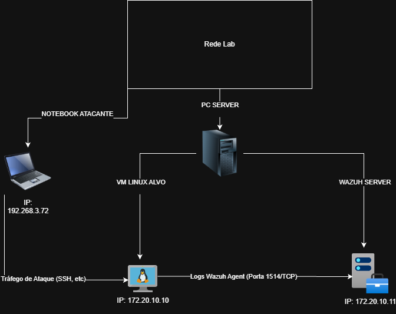

# Mini-SOC

Este repositório documenta a criação de forma isolada de um Mini-SOC.

**Todos os registros nesse repositório foram adquiridos em ambiente isolado. Nenhuma técnica foi aplicada contra alvos reais ou externos.**

| Máquina | Sistema Operacional | IP (Interno) | Função |
|---|---|---|---|
| Virtual | Wazuh | 172.20.10.11 | Wazuh Server |
| Virtual | Ubuntu Server | 172.20.10.10 | Alvo de Ataques |
| Física  | Ubuntu | 172.20.10.12 | Atacante |

## Ferramentas Usadas
Wazuh, Ubuntu, Oracle VirtualBox.

## Coleta de Dados (Agente)
O agente Wazuh foi instalado na VM Ubuntu Server (Alvo). Foi validado no arquivo `/var/ossec/etc/ossec.conf` do agente que a coleta do log de autenticação (`/var/log/auth.log`) e do syslog estão ativas para garantir a detecção de eventos dos serviços do sistema.

## Relatórios de Incidente (Simulações Controladas)
* [Relatório de Incidente 01 — Brute Force SSH com Comprometimento de Conta (MITRE ATT&CK T1110)](labs/lab-011-brute-force/relatorio.md)
